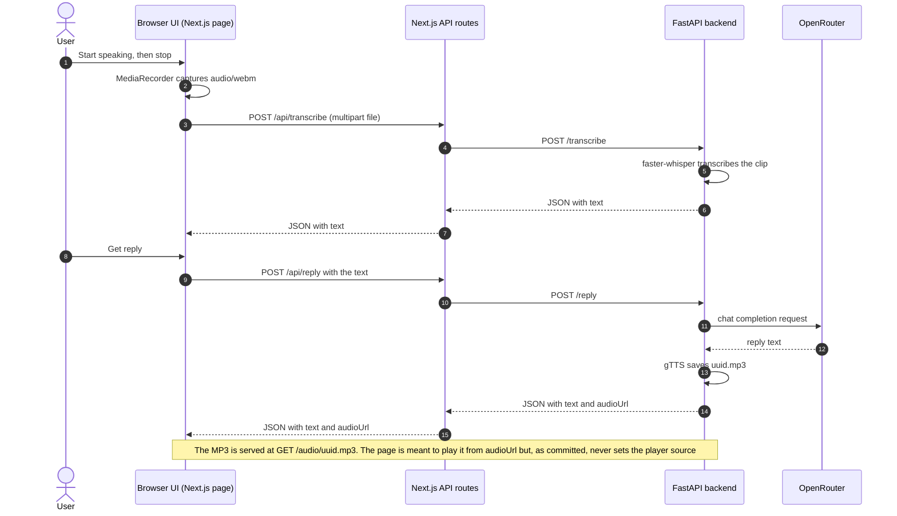

# Voice Assistant

A prototype browser voice assistant: speak into the microphone, get a Whisper transcript, an AI reply from an LLM, and a text-to-speech audio version of that reply.


> Status: app - Type: full-stack web app (Next.js frontend + FastAPI backend)

## Overview

The goal of this project is a simple, end-to-end voice interface to a large language model. A visitor presses a button and speaks, the page shows what was heard, and an LLM answers. The backend also converts the answer to speech, but the page's audio player is not wired up to it yet (see [Limitations](#limitations-and-known-issues)). A live audio visualizer and an animated landing-page style UI surround the demo (the in-page title is "Project Voice - Classy Edition", with the tagline "Speak it. See it come alive.").

The work is split into two parts: a **Next.js 14 frontend** that records audio and renders the UI, and a **FastAPI backend** that does the heavy lifting (speech-to-text with [faster-whisper](https://github.com/SYSTRAN/faster-whisper), a chat completion through [OpenRouter](https://openrouter.ai/), and text-to-speech with [gTTS](https://github.com/pndurette/gTTS)). The Next.js server only proxies two requests to the backend, so the browser calls the transcription and reply APIs on its own origin.

This repository contains no benchmarks or evaluation of transcription quality or latency; it is a working prototype, not a measured system.

## Contents

| Folder | What it is | Docs |
|---|---|---|
| [frontend/](frontend/) | Next.js 14 (App Router) single-page UI and the `/api/transcribe` and `/api/reply` proxy routes | [frontend/README.md](frontend/README.md) |
| [backend/](backend/) | FastAPI service: Whisper transcription, OpenRouter reply, gTTS speech, audio file serving | [backend/README.md](backend/README.md) |

## Features

- **Microphone recording in the browser** with `MediaRecorder` (`audio/webm`) and a live energy-based waveform driven by a Web Audio `AnalyserNode`.
- **Server-side speech-to-text** with faster-whisper (`base` model, English).
- **LLM replies** through the OpenRouter chat-completions API (model `deepseek/deepseek-chat-v3.1:free`, system prompt "You are a helpful AI assistant.").
- **Spoken replies (backend side)**: the backend turns the reply into an MP3 with gTTS and returns its URL. The page shows play/pause and mute buttons, but as committed the player is never given that URL, so the audio does not play from the UI (see Limitations); the MP3 file itself is served by the backend at `/audio/<file>`.
- **Editable transcript**: the transcript is a text box, so a message can be typed instead of spoken (the "Get reply" button works without a microphone), and a styled preview is meant to render each word in a different size and color (a regex bug currently makes it treat the whole text as one word, see Limitations).
- **Landing-page sections** (Features, Presets, Use Cases, Pricing, FAQ) around the demo. These are static, placeholder marketing content: nothing is billed and the presets do not change the assistant's behavior.

## Architecture



Notes on the flow:

- The OpenRouter key stays on the backend: it is read from the backend's `.env` and is never sent to the browser.
- The recording is uploaded automatically when recording stops; the reply is requested only when the user presses "Get reply".
- The MP3 is served by the backend at the `audioUrl` it returns, which is hardcoded to `http://localhost:8000/audio/<file>`. The page is meant to load it directly from there, but `Stage3Page.tsx` never assigns the URL to its `<audio>` element (see [Limitations](#limitations-and-known-issues)).

### API endpoints

| Service | Method and path | Purpose |
|---|---|---|
| Backend | `GET /health` | Returns `{"ok": true}` |
| Backend | `POST /transcribe` | Multipart upload (field `file`), returns `{"text": "..."}` |
| Backend | `POST /reply` | JSON `{"text": "..."}`, returns `{"text": "...", "audioUrl": "..."}` |
| Backend | `GET /audio/{filename}` | Serves a generated reply as `audio/mpeg` |
| Frontend | `POST /api/transcribe` | Proxies to the backend `/transcribe` |
| Frontend | `POST /api/reply` | Proxies to the backend `/reply` |

FastAPI also serves interactive docs at `/docs` while the backend is running.

## Tech stack

| Layer | Technology |
|---|---|
| Frontend | Next.js 14.2.5 (App Router), React 18.3.1, TypeScript, Tailwind CSS 3, Framer Motion 11, lucide-react |
| Backend | Python 3.11, FastAPI 0.115, Uvicorn, faster-whisper 1.0.3, gTTS, requests, python-dotenv, Pydantic 2 |
| External services | OpenRouter (LLM), Google text-to-speech via gTTS (needs internet), Hugging Face Hub (Whisper weights, downloaded on first start) |
| Packaging | npm (frontend), pip with `requirements.txt` (backend), optional Dockerfile for the backend |

Versions are taken from `frontend/package.json` and `backend/requirements.txt`.

## Data

This project has no dataset. The Whisper model weights (`Systran/faster-whisper-base`) are downloaded automatically by faster-whisper from the Hugging Face Hub the first time the backend starts, and are not committed. Generated reply audio is written to `backend/audio/` (or `backend/app/audio/`, depending on where the server is started) and is git-ignored.

## How to run

### Prerequisites

- Python 3.11 (the Dockerfile also uses 3.11; in a test, the PyAV dependency of faster-whisper 1.0.3 failed to build from source on Python 3.13)
- Node.js 18.17 or newer (`engines` in `frontend/package.json`)
- An NVIDIA GPU with working CUDA and cuDNN libraries for CTranslate2, because the backend is hardcoded to `device="cuda"` (see Limitations)
- An [OpenRouter](https://openrouter.ai/) API key
- A modern browser with microphone access (`localhost` counts as a secure context)

### 1. Backend

```bash
cd backend
python3.11 -m venv .venv && source .venv/bin/activate   # Windows: .venv\Scripts\activate
pip install -r requirements.txt
cp .env.example .env            # then set OPENROUTER_API_KEY in .env
uvicorn app.main:app --host 0.0.0.0 --port 8000 --reload
```

Start `uvicorn` from `backend/`: reply audio is saved to a relative `audio/` folder, so the working directory decides where it lands. Check the server with `curl http://localhost:8000/health`.

### 2. Frontend

```bash
cd frontend
cp .env.example .env.local      # FASTAPI_URL=http://localhost:8000
npm install
npm run dev
```

Open http://localhost:3000, allow microphone access, press **Start speaking**, press it again to stop (the transcript appears), then press **Get reply**. `npm run build` followed by `npm start` runs the production build.

### Configuration

| Variable | Where | Purpose |
|---|---|---|
| `OPENROUTER_API_KEY` | `backend/.env` | Key used for the OpenRouter chat-completions call |
| `FASTAPI_URL` | `frontend/.env.local` | Base URL of the backend that the Next.js API routes proxy to (`http://localhost:8000` locally) |

Both `.env.example` files contain variable names only. Real `.env` files are git-ignored.

The Whisper model size, device and compute type are **not** configurable by environment variable: they are hardcoded in `backend/app/main.py` as `WhisperModel("base", device="cuda", compute_type="float32")`.

### Docker (backend)

A `backend/Dockerfile` is provided (`python:3.11-slim` plus ffmpeg, serving `app.main:app` on port 8000):

```bash
cd backend
docker build -t voice-backend .
docker run --rm -p 8000:8000 --env-file .env voice-backend
```

This image has not been verified and is inconsistent with the code: it sets `WHISPER_MODEL_SIZE`, `FASTER_WHISPER_DEVICE` and `FASTER_WHISPER_COMPUTE_TYPE` variables that `main.py` never reads, and the slim base image contains no CUDA libraries while `main.py` requests `device="cuda"`. Expect the model load to fail in this container until the backend reads those settings.

### Deployment notes

`frontend/` is a self-contained Next.js app. If it is deployed to a platform such as Vercel, set the project's root directory to `frontend` and define `FASTAPI_URL` for it. The backend must be hosted separately, and the hardcoded `localhost:8000` audio URL means spoken replies will not play from a deployed frontend until that is changed.

## Project structure

```text
voice-assistant/
├── README.md                       # This file
├── .gitignore                      # Python, Node and env ignores (keeps .env.example), generated audio
├── backend/                        # FastAPI service (see backend/README.md)
│   ├── README.md
│   ├── .env.example                # OPENROUTER_API_KEY
│   ├── Dockerfile
│   ├── requirements.txt
│   └── app/
│       └── main.py                 # All endpoints: /health, /transcribe, /reply, /audio/{filename}
└── frontend/                       # Next.js 14 app (see frontend/README.md)
    ├── README.md
    ├── .env.example                # FASTAPI_URL
    ├── package.json
    ├── package-lock.json
    ├── next.config.js
    ├── next-env.d.ts
    ├── postcss.config.mjs
    ├── tailwind.config.ts
    ├── tsconfig.json
    ├── public/
    │   └── favicon.ico             # Empty (0 bytes) placeholder
    ├── app/
    │   ├── layout.tsx              # Root layout and page metadata
    │   ├── page.tsx                # Renders Stage3Page
    │   ├── globals.css
    │   └── api/
    │       ├── reply/route.ts      # Proxy to backend /reply
    │       └── transcribe/route.ts # Proxy to backend /transcribe
    └── src/
        ├── components/
        │   └── Stage3Page.tsx      # The whole UI: recorder, visualizer, reply player, landing sections
        └── lib/
            └── api.ts              # Browser-side helpers that call /api/transcribe and /api/reply
```

## Limitations and known issues

- **GPU required as written.** `main.py` hardcodes `WhisperModel("base", device="cuda", compute_type="float32")` and loads it at import time, so the backend does not start on a machine without a working CUDA setup. Earlier documentation mentioned `tiny.en` and CPU `int8` settings; the code does not read any of them.
- **Reply audio does not play from the UI.** In `Stage3Page.tsx`, `handleSubmit` sets `audioRef.current.src` right after `setReply(resp)`, but the `<audio>` element is only rendered once the reply state has been committed (and is unmounted by the `setReply(null)` at the start of each request), so `audioRef.current` is still `null` at that point and the source is never set. In a jsdom render with a mocked `/api/reply` response, the `<audio>` element had no `src` and the **Play audio** button called `play()` on a source-less element. This was not tested in a real browser.
- **Hardcoded audio URL.** `/reply` always returns `http://localhost:8000/audio/<file>`, which only works when the backend runs on the same machine as the browser, and would be mixed content if the frontend were served over HTTPS.
- **Fragile error path in `/reply`.** If the request to OpenRouter fails before any response arrives (for example a timeout or DNS failure), the error handler reads an unassigned variable and the endpoint returns HTTP 500 (reproduced locally with a simulated network error). HTTP error statuses returned by OpenRouter instead produce the fallback text "Sorry, I couldn't generate a reply.", which is still converted to speech.
- **Free model dependency.** The reply model is `deepseek/deepseek-chat-v3.1:free`; its availability and rate limits are controlled by OpenRouter.
- **Open CORS.** The backend allows all origins (`allow_origins=["*"]`) and defines an `origins` list for `localhost:3000` and `localhost:5173` that is not used. There is no authentication or rate limiting.
- **Files accumulate.** Generated MP3s are never deleted, and uploaded clips are written to temporary files that are not removed.
- **English only.** Transcription is forced to `language="en"` and gTTS is called with its default language.
- **Placeholder marketing copy.** The Pricing, Presets and FAQ sections are static. The "Privacy-first" card says mic processing is local until you submit, but in server-ASR mode the recording is uploaded to the backend as soon as recording stops. A browser `SpeechRecognition` fallback exists in the code but is switched off (`USE_SERVER_ASR = true`).
- **Styled preview quirk.** `Stage3Page.tsx` splits the transcript with `/\\s+/` (a literal backslash followed by `s`), so the styled preview treats the whole transcript as one word instead of styling each word.
- **Empty favicon.** `frontend/public/favicon.ico` is a 0-byte file.
- **No tests or measurements.** There are no automated tests, and no accuracy or latency figures are recorded.

## Credits

- [faster-whisper](https://github.com/SYSTRAN/faster-whisper) (SYSTRAN) and the OpenAI Whisper model it runs, via the `Systran/faster-whisper-base` weights on the Hugging Face Hub
- [OpenRouter](https://openrouter.ai/) and the DeepSeek chat model it routes to
- [gTTS](https://github.com/pndurette/gTTS) (Google Translate text-to-speech)
- [FastAPI](https://fastapi.tiangolo.com/), [Next.js](https://nextjs.org/), [React](https://react.dev/), [Tailwind CSS](https://tailwindcss.com/), [Framer Motion](https://www.framer.com/motion/) and [lucide-react](https://lucide.dev/)

## License

No license file - all rights reserved by the respective authors.
